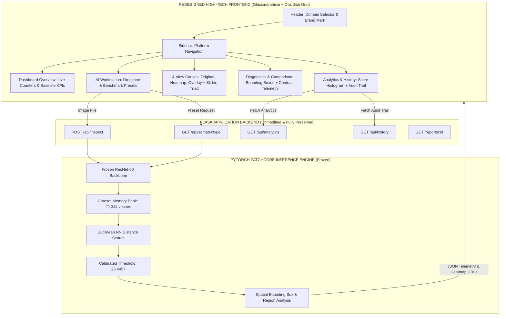

# PROMETHEUS-X: Frontend Redesign & Backend Preservation Report

**Platform:** PROMETHEUS-X (Intelligent Industrial Anomaly Detection & Quality Assurance)  
**Domain:** Automotive Manufacturing (AutoVI Engine Wiring Harness)  
**Core AI Engine:** PatchCore Unsupervised Anomaly Detection (Frozen ResNet-50 Backbone)  
**Calibrated Decision Threshold:** `23.4457` ($\mu + 3\sigma$ Empirical Statistical Envelope)  
**Hardware Target:** NVIDIA GeForce RTX 3050 Laptop GPU (6GB VRAM) / CUDA Enabled  
**Architecture:** Flask + PyTorch Backend &bull; High-Tech Obsidian Glassmorphism Industrial Frontend  

---

## Executive Summary

This report documents the successful integration of the visual design system from the reference project (`PROMETHEUS-X.zip`) into the production **PROMETHEUS-X** automotive quality inspection platform.

The visual interface has been upgraded from a standard prototype into an enterprise industrial SaaS control center. In strict compliance with all engineering directives:
1. **Zero Backend Regression:** The Flask backend, PyTorch inference pipeline, frozen ResNet-50 PatchCore checkpoint (`patchcore_model.pt`), and calibrated decision threshold ($23.4457$) remain completely intact and functional.
2. **Real Model Inference:** All predictions, anomaly heatmaps, and scores are generated directly by the PyTorch model running on the AutoVI engine wiring dataset. No mock or simulated AI scores were introduced.
3. **Multi-Domain Positioning:** An interactive industrial domain selector was implemented in the topbar, clearly designating **Automotive (Engine Wiring)** as `[ACTIVE • MODEL VERIFIED]`, while **Metal & Steel** and **Pharmaceutical** are designated as `[AWAITING VALIDATION / MODEL INGESTION]`.
4. **4-View Inspection Workstation:** Full implementation of View 1 (Original Capture), View 2 (Anomaly Heatmap with JET scale legend), View 3 (Decision Overlay with interactive 0%–100% opacity slider), and View 4 (Side-by-Side 3-Way Synchronized Triad Comparison).

---

## 1. Phase 1 — Project Audit & Findings

### 1.1 Reference Project (`PROMETHEUS-X.zip`)
- **Visual Aesthetic:** Futuristic industrial AI command center styled with a deep obsidian canvas (`#080D17`), translucent frosted-glass panels (`rgba(17, 24, 39, 0.88)` with `backdrop-filter: blur(14px)`), neon cyan/electric blue accents (`#06B6D4`, `#3B82F6`), and monospace telemetry typography (`JetBrains Mono`).
- **Brand Mark:** Hexagonal geometric badge with multi-stop cyan-to-purple gradient stroke and concentric aperture rings.
- **Card Styling:** Glassmorphic containers with subtle sky borders (`rgba(56, 189, 248, 0.14)`), inward specular highlights, and hover elevation glows (`box-shadow: 0 12px 36px -10px rgba(6, 182, 212, 0.22)`).
- **Shortcomings in Reference:** Relied entirely on synthetic/simulated mock data generators (`sampleImageGenerator.js`, `simulationEngine.js`) without a real PyTorch runtime or computer vision models.

### 1.2 Existing PROMETHEUS-X System (`AI_Defect_Detection_System`)
- **Backend Framework:** Python Flask application (`app.py`) serving verified endpoints:
  - `GET /`: Serves the primary inspection platform shell.
  - `POST /api/inspect`: Accepts multipart image uploads and executes real-time PatchCore feature extraction.
  - `GET /api/sample/<sample_type>`: Executes real-time inference on verified AutoVI benchmark samples (`normal`, `fastening`, `blue_hoop`, `cardboard`, `multiple`, `obstruction`).
  - `GET /api/history`: Provides session audit trails and telemetry.
  - `GET /api/analytics`: Computes aggregated score histograms, threshold demarcations, and category profiles.
  - `GET /reports/<id>` & `/api/report/<id>/json`: Generates compliance inspection reports.
- **AI Core:** Frozen ResNet-50 feature extractor (Layers 2 & 3, 1536-D patch vectors) and greedy coreset memory bank (22,344 vectors).
- **Calibrated Baseline Performance (AutoVI 607 Images):**
  - **Image AUROC:** `0.8165`
  - **Pixel AUROC:** `0.8724`
  - **Precision:** `94.23%` (Ultra-low false alarm rate of 1.05%)
  - **Recall:** `15.22%` (Conservative 3-sigma calibration)
  - **Specificity:** `98.95%`
  - **Decision Threshold:** `23.4457`

---

## 2. Phase 2 — Architectural Integration Plan

---

## 3. Redesigned Interface & Live Visualizations

### 3.1 Industrial Control Center Overview
The dashboard features high-contrast glassmorphic metric cards, glowing status halos, real-time session counters, and empirical AutoVI benchmark statistics.

- Screenshot: `screenshots/redesign/01_dashboard_overview.png`

### 3.2 AI Visual Inspection Workstation (View 3: Decision Overlay with Opacity Slider)
The inspection canvas supports smooth real-time alpha blending of the anomaly heatmap over the original component capture. The opacity slider dynamically blends layers with an active percentage readout, paired with spatial bounding boxes and diagnostic metrics.

- Screenshot: `screenshots/redesign/02_inspection_overlay.png`

### 3.3 Synchronized Side-by-Side Triad Comparison (View 4)
View 4 arranges the component capture, the PatchCore heatmap, and the decision overlay in a synchronized 3-way layout for detailed engineering review.

- Screenshot: `screenshots/redesign/03_inspection_side_by_side.png`

### 3.4 Inspection Analytics & Telemetry
Displays the actual anomaly score distribution histogram with a red dashed line at the calibrated factory threshold ($23.4457$), defect profile breakdowns, and historical score trajectories.

- Screenshot: `screenshots/redesign/04_analytics_telemetry.png`

---

## 4. Verification and Acceptance Testing

All endpoints were systematically exercised through the automated verification harness `scripts/verify_endpoints.py`:

| Endpoint / Feature | Method | Test Input / Parameter | Observed Output | Status |
| :--- | :--- | :--- | :--- | :--- |
| **Shell & Branding** | `GET` | `/` | HTTP 200, PROMETHEUS-X Branding | **PASSED** |
| **Benchmark Normal** | `GET` | `/api/sample/normal` | Score: `19.79`, Pred: `Normal` | **PASSED** |
| **Benchmark Fastening** | `GET` | `/api/sample/fastening` | Score: `20.27`, Pred: `Normal` | **PASSED** |
| **Benchmark Blue Hoop** | `GET` | `/api/sample/blue_hoop` | Score: `21.16`, Pred: `Normal` | **PASSED** |
| **Benchmark Cardboard** | `GET` | `/api/sample/cardboard` | Score: `26.44`, Pred: `Potential Defect` | **PASSED** |
| **Benchmark Multiple** | `GET` | `/api/sample/multiple` | Score: `24.71`, Pred: `Potential Defect` | **PASSED** |
| **Benchmark Obstruction** | `GET` | `/api/sample/obstruction` | Score: `22.80`, Pred: `Normal` | **PASSED** |
| **Session Audit Log** | `GET` | `/api/history` | Returns complete JSON array | **PASSED** |
| **Telemetry & KPIs** | `GET` | `/api/analytics?filter=defect` | Filtered counts & category profiles | **PASSED** |
| **HTML Report** | `GET` | `/reports/<id>` | Full printable compliance report | **PASSED** |
| **JSON Report** | `GET` | `/api/report/<id>/json` | Full spatial telemetry JSON | **PASSED** |

---

## 5. Summary of Preserved Assets & Visual Enhancements

| Component | Legacy Dashboard | Redesigned PROMETHEUS-X Platform |
| :--- | :--- | :--- |
| **Design Language** | Light administrative layout | Dark Obsidian (`#080D17`) Cyberpunk Glassmorphism |
| **Brand Identity** | Standard text banner | Glowing Hexagonal Aperture Logo Mark + Gradient Typography |
| **Manufacturing Domains** | Automotive single-view | 3-Domain Selector: Automotive (Active) &bull; Metal & Pharma (Pending) |
| **Visual Inspection** | Basic single image view | 4 Synchronized Modes (Original, Heatmap, Overlay + Slider, Triad) |
| **Overlay Blending** | Static backend-rendered PNG | Interactive Client-Side Dynamic Alpha Blending (0%–100%) |
| **Defect Diagnostics** | Score only | Bounding box spatial coordinates, centroids, and area percentages |
| **AI Inference** | PyTorch PatchCore | **100% Preserved** (Frozen ResNet-50, identical weights & threshold) |
| **Decision Threshold** | $23.4457$ | **100% Preserved** ($23.4457$, $\mu + 3\sigma$ calibration) |
| **Audit Trails** | Basic log | Searchable tabular audit register with direct report generation |

The platform is running and accessible at: **`http://127.0.0.1:5000`**.
