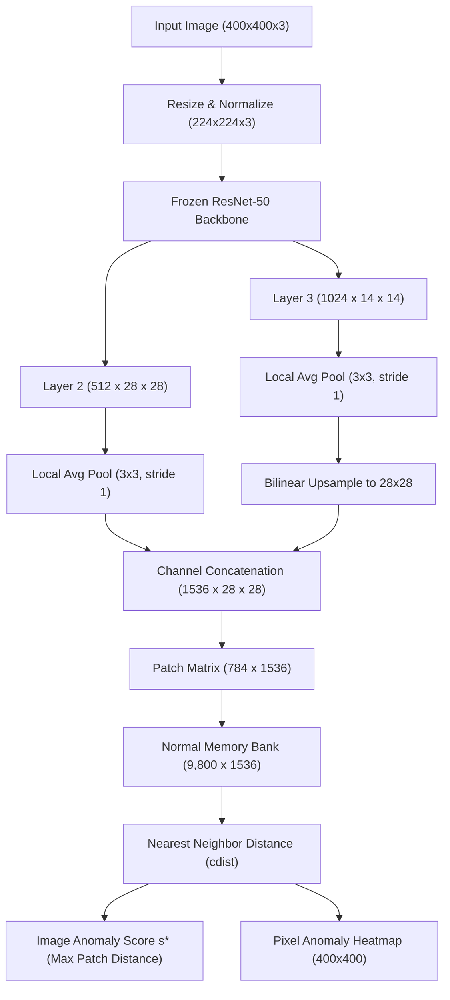

# PROMETHEUS-X: Automotive PatchCore Architecture Specification

**Project:** PROMETHEUS-X  
**Domain:** Automotive Manufacturing Visual Inspection  
**Dataset:** AutoVI (`engine_wiring`)  
**Target:** Unsupervised Industrial Anomaly Detection & Defect Localization  

---

## 1. Architectural Overview

PatchCore is an unsupervised industrial visual anomaly detection framework based on the principle that abnormal samples deviate locally from normal patch-level visual representations. Rather than updating neural network parameters through iterative gradient descent, PatchCore leverages a fixed, pre-trained convolutional feature extractor to build a non-parametric **Memory Bank** of nominal patch feature vectors.

---

## 2. Core Methodological Components

### 2.1 Multi-Scale Feature Representation
- **Backbone:** Official ImageNet-pre-trained ResNet-50 (`ResNet50_Weights.DEFAULT`), completely frozen (`requires_grad = False`).
- **Target Layers:** 
  - `layer2`: Captures mid-level structural features, edges, and wire textures ($512$ channels, spatial grid $28 \times 28$).
  - `layer3`: Captures higher-level semantic arrangements of clips and brackets ($1024$ channels, spatial grid $14 \times 14$).
- **Receptive Field Aggregation:** A $3 \times 3$ adaptive average pooling operation (stride 1, padding 1) is applied to both layers, expanding each feature's effective receptive field to encompass surrounding neighborhood context.
- **Bilinear Alignment:** `layer3` is interpolated to $28 \times 28$ to align spatially with `layer2`.
- **Feature Concatenation:** Concatenating aligned features yields a rich $1536$-dimensional vector for each of the $28 \times 28 = 784$ spatial patch locations.

### 2.2 Memory-Efficient Approximate Coreset Subsampling
Raw feature extraction over 250 normal images yields $196,000$ patch vectors ($\sim 1.15$ GB raw tensor). To prevent memory exhaustion within the 2.18 GB system RAM budget:
1. **Johnson-Lindenstrauss Random Projection:** Patch vectors are projected from $\mathbb{R}^{1536}$ into a compact subspace $\mathbb{R}^{128}$ using an orthonormal random projection matrix $P \in \mathbb{R}^{1536 \times 128}$.
2. **Greedy Minimax Selection ($k$-Center):** Starting with a random seed vector, the algorithm iteratively selects the patch that maximizes the minimum Euclidean distance to previously chosen centers:
   $$\mathbf{m}_{t+1} = \arg\max_{\mathbf{x} \in \mathcal{P}} \min_{\mathbf{m} \in \mathcal{M}_t} \|\mathbf{x} - \mathbf{m}\|_2$$
3. **5% Coreset Ratio:** Subsamples exactly $9,800$ representative patch vectors, compressing the memory bank from $1.15$ GB down to **57.42 MB** while preserving the geometric coverage of nominal feature space.

### 2.3 Anomaly Scoring & Heatmap Generation
- **Patch Distance:** For any test image, each patch $\mathbf{p}_i$ is evaluated against the memory bank $\mathcal{M}$:
  $$s(\mathbf{p}_i) = \min_{\mathbf{m} \in \mathcal{M}} \|\mathbf{p}_i - \mathbf{m}\|_2$$
- **Image-Level Score:** The image anomaly score $s^*$ is defined as the maximum patch-level anomaly score:
  $$s^* = \max_{i} s(\mathbf{p}_i)$$
- **Pixel-Level Heatmap:** The $28 \times 28$ patch distance map is upsampled via bilinear interpolation back to the original image dimensions ($400 \times 400$) and smoothed using a Gaussian filter ($\sigma = 4.0$) to produce a clean inspection heatmap.
